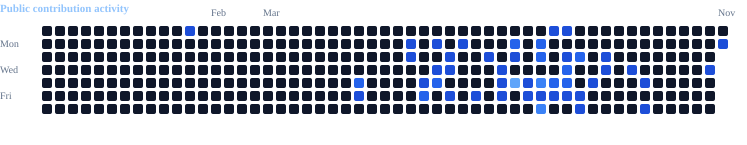

  
  
  

  
<strong>Cybersecurity Governance &amp; GRC Consultant</strong>

  
IT Manager, Privacy Professional, and Auditor focused on cybersecurity governance and GRC.

## About Me

- I work across IT, privacy, auditing, and cybersecurity governance.

---

## Articles

- Read more of my articles on [Privacy Evolution](https://privacyevolution.substack.com/)
<!-- START:latest-articles -->
<table>
  <tr>
    <td width="50%" valign="top">
      
             <a href="https://privacyevolution.substack.com/p/one-page-a-day-and-six-agents-arguing"><strong>One page a day, and six agents arguing about it</strong></a>
       
      Sep 26, 2026
    </td>
    <td width="50%" valign="top">
      
             <a href="https://privacyevolution.substack.com/p/building-eve-a-private-ai-research"><strong>Building Eve: A Private AI Research Agent for Cybersecurity and Privacy</strong></a>
       
      Aug 28, 2026
    </td>
  </tr>
</table>
<!-- END:latest-articles -->

---

## Certifications

  
  
  
  
  

- CIPP/E (Certified Information Privacy Professional/Europe) — International Association of Privacy Professionals (IAPP)
- CIPM (Certified Information Privacy Manager) — International Association of Privacy Professionals (IAPP)
- Europrivacy Auditor
- Google Cybersecurity Professional Certificate — Google
- Google IT Support Professional Certificate — Google

---

## Technology Stack

  

  
  
  
  
  
  
  
  
  
  
  
  
  

---

## Featured Projects

- [Governance-Risk-Compliance-Toolbox](https://github.com/ghostlucius/Governance-Risk-Compliance-Toolbox)  
  Curated repository of privacy, governance, data protection, and cybersecurity references for practical research and program support.

- [cf7-international-phone-prefix](https://github.com/ghostlucius/cf7-international-phone-prefix)  
  WordPress plugin that adds international phone selection and normalizes submitted numbers to E.164 for downstream CRM and automation workflows.

- [VideoFixer](https://github.com/ghostlucius/VideoFixer)  
  Lightweight Windows utility built to simplify video repair workflows through an accessible interface around `ffmpeg`.

---

## Statistics

<!-- START:statistics -->
- Public repositories: 7
- Followers: 3
- Following: 12
- Account created: October 2021
- Top public repository languages by repository count: JavaScript (2), PHP (1), Python (1), Swift (1)

<!-- END:statistics -->

---

## Recent Activity

<!-- START:recent-activity -->
- Nov 12, 2026: Starred [mattpocock/skills](https://github.com/mattpocock/skills).
- Nov 10, 2026: Starred [seedds/nxnative](https://github.com/seedds/nxnative).
- Nov 9, 2026: Starred [m0s4ik/home-companion](https://github.com/m0s4ik/home-companion).
- Oct 25, 2026: Starred [hevnsnt/CVEngine](https://github.com/hevnsnt/CVEngine).
- Oct 17, 2026: Starred [vibheksoni/stealth-browser-mcp](https://github.com/vibheksoni/stealth-browser-mcp).
<!-- END:recent-activity -->

---

## Latest Repositories

<!-- START:latest-repos -->
- [hibimekuri](https://github.com/ghostlucius/hibimekuri) · Swift — Hibimekuri — a native macOS himekuri (tear-off calendar) app for daily journaling, with real astronomical almanac detail and a persistent task list, in a minimal paper-and-ink interface.
- [starred-repositories-catalog](https://github.com/ghostlucius/starred-repositories-catalog) — A categorized catalog of useful open-source projects, tools, learning resources, and experiments.
- [rock_paper_scissor](https://github.com/ghostlucius/rock_paper_scissor) · JavaScript — No description yet.
<!-- END:latest-repos -->

---

## Metrics

